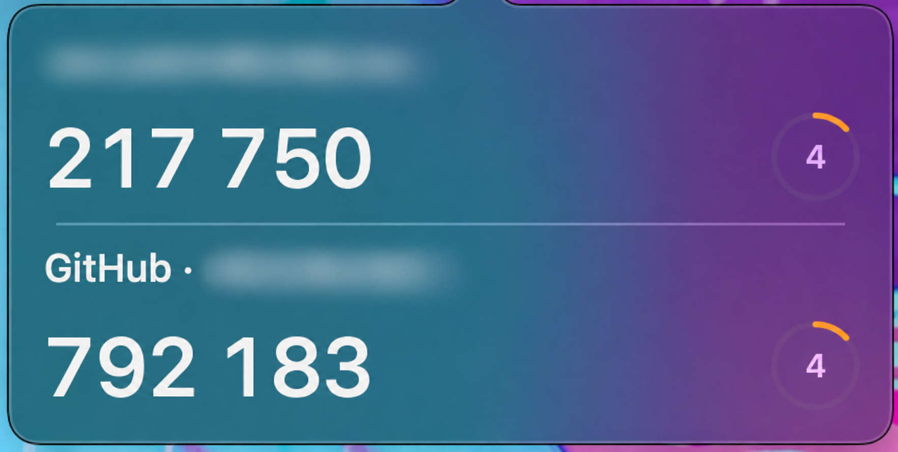

# Mac Authenticator

[English](README.md)

原生 SwiftUI 菜单栏验证器。一次导入 Google Authenticator 账号，即可在 Mac 上查看和复制相同的验证码。



*上图为精简视图。首次安装默认使用完整视图，显示搜索框和导入按钮。*

## 安装

需要搭载 Apple 芯片、运行 macOS 14 或更新版本的 Mac。

1. 从 [Releases](https://github.com/mikotokuroko/mac-authenticator/releases/latest) 下载 **MacAuthenticator-arm64.zip**。
2. 解压，将 **Mac Authenticator.app** 拖入“应用程序”。
3. 打开应用，点击菜单栏中的**钥匙图标**。

应用使用临时签名。如果 macOS 阻止首次启动，前往**系统设置 → 隐私与安全性 → 仍要打开**，然后重新打开应用。

## 添加账号

1. 使用触控 ID 或 Mac 登录密码解锁应用。
2. 在 iPhone 的 Google Authenticator 中选择**转移账号 → 导出账号**。
3. 在 Mac 上点击 **+ → Import QR Image…**，选择二维码图片；也可以复制图片后选择 **Paste QR**。
4. 如果导出时出现多个二维码，依次导入即可。

iPhone 上的账号会保留。Mac 根据已导入的账号在本地生成验证码；在手机上新增或重置账号后，需要重新导入对应账号。

## 使用与设置

点击账号即可复制验证码，倒计时显示剩余有效时间。完整视图提供账号搜索框和 **+** 导入菜单。

**在弹出窗口内点击右键**，即可访问设置和操作：

| 选项 | 功能 |
| --- | --- |
| Simplified View | 仅显示账号名称、验证码和倒计时。取消勾选可恢复完整视图，应用会记住你的选择。 |
| Lock Codes | 立即锁定应用。 |
| Import QR Image… / Paste QR | 解锁后导入账号。 |
| Quit Authenticator | 锁定并退出应用。 |

右键点击账号，选择 **Remove from Mac…** 可删除该账号在 Mac 上的副本。

如需开机启动，在**系统设置 → 通用 → 登录项**中添加 **Mac Authenticator.app**。

## 功能

- 原生 SwiftUI 界面，使用 macOS 弹出窗口材质。
- 支持 Google Authenticator 导出二维码及标准 TOTP 二维码。
- 支持 SHA-1、SHA-256、SHA-512，以及六位和八位验证码。
- 账号保存在本机 macOS 钥匙串中。
- 使用触控 ID 或 Mac 密码解锁；锁屏、睡眠、切换用户或退出时自动锁定。
- 复制的验证码会在 30 秒后或锁定时清除，前提是剪贴板内容未被替换。
- 支持减弱动态效果、降低透明度和增强对比度。

## 构建

需要安装包含 Swift 6 或更新版本的 Xcode。

```sh
./test.sh
./build.sh
open 'dist/Mac Authenticator.app'
```

使用示例账号预览界面：

```sh
open -n 'dist/Mac Authenticator.app' --args --demo
```
